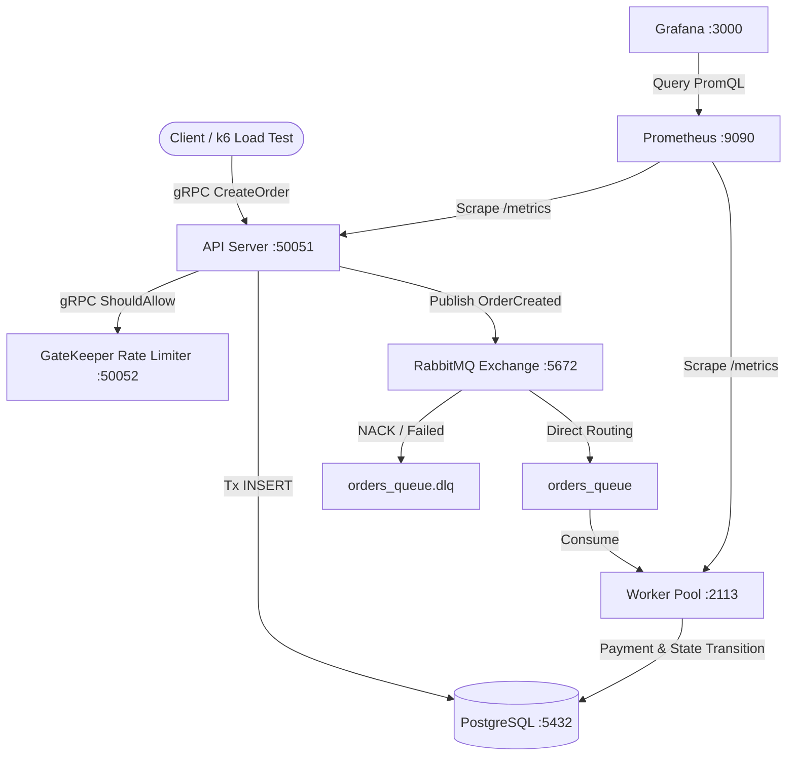

# Order Flow Engine — Distributed Order Processing Pipeline

A high-throughput, fault-tolerant distributed order processing pipeline written in Go. Accepts client orders over gRPC, performs rate-limiting checks via [GateKeeper](https://github.com/arthkinq/gatekeeper), publishes tasks to RabbitMQ, and processes orders concurrently using a Worker Pool backed by PostgreSQL transactions.

---

## Architecture Diagram



---

## Tech Stack

| Technology | Purpose |
|---|---|
| Go 1.22+ | Core programming language |
| gRPC & Protobuf | Client API contract (`CreateOrder`, `GetOrder`) |
| RabbitMQ | Message broker with Direct Exchange, Manual ACKs, and DLQ |
| PostgreSQL 16 | Relational storage for orders and line items with ACID transactions |
| [GateKeeper](https://github.com/arthkinq/gatekeeper) | Distributed rate limiter integration (Fail-Open policy) |
| Prometheus & Grafana | Metrics collection (`orders_created_total`, `orders_processed_total`, latency), SLO alerts, and pre-provisioned SRE dashboard |
| Docker Compose & Kubernetes (`kind`) | Container orchestration, `Deployment`/`Service`/`ConfigMap` manifests, liveness/readiness probes, non-root containers, CPU/RAM limits |
| k6 | Automated gRPC load testing |

---

## Key Design Decisions

1. **Fail-Open Policy on Rate Limiter**: If [GateKeeper](https://github.com/arthkinq/gatekeeper) is unavailable or times out (>200ms), the API fails open to maintain business availability over rate-limit strictness.
2. **Exponential Backoff Retries, Manual ACKs & Dead Letter Queue (DLQ)**: Workers use manual acknowledgments (`autoAck = false`) and retry transient DB failures with exponential backoff before routing unprocessable messages to `orders_queue.dlq` for post-mortem analysis.
3. **Structured Observability & SLO Alerting**: Structured JSON logging via `log/slog` with `order_id` correlation, Prometheus counters/histograms, Alertmanager rules for availability/error-rate/p95 latency SLOs, and a pre-provisioned Grafana dashboard.
4. **State Machine & Data Integrity**: Order state transitions (`PENDING -> PROCESSING -> COMPLETED / FAILED`) are strictly enforced via a domain map. Prices are stored in integer cents (`int64 price_cents`) to avoid floating-point rounding errors.
5. **Graceful Shutdown**: All services handle `SIGINT` / `syscall.SIGTERM`. Workers finish in-flight order payments (`sync.WaitGroup`) before terminating cleanly.

---

## Directory Structure

```
order-flow-engine/
├── cmd/
│   ├── api/               # gRPC API Server
│   └── worker/            # Background Worker Pool
├── internal/              # Internal packages (domain, repository, queue, server, worker, ratelimit, metrics)
├── proto/order/v1/        # Protobuf definition and Go stubs
├── migrations/            # SQL migration files
├── deployments/           # Docker Compose, Prometheus, Grafana, and Kubernetes (k8s/) manifests
├── tests/                 # Integration tests & k6 load testing script
│   ├── integration_test.go
│   └── load/k6_test.js
├── Dockerfile             # Multi-stage non-root build specification
└── Makefile
```

---

## Quick Start

### Prerequisites
- Go 1.22+
- Docker Desktop
- `kubectl` & `kind` (optional, for local Kubernetes deployment)

### Option A: Launch via Docker Compose
Start PostgreSQL, RabbitMQ, API Server, Worker Pool, Prometheus, and Grafana:

```bash
make docker-up
```

Check Service Endpoints:
- **gRPC API**: `localhost:50051`
- **RabbitMQ Management Dashboard**: http://localhost:15672 (User: `guest`, Pass: `guest`)
- **Prometheus UI**: http://localhost:9090
- **Grafana Dashboard**: http://localhost:3000 (User: `admin`, Pass: `admin`)
- **API Metrics**: http://localhost:2112/metrics
- **Worker Metrics**: http://localhost:2113/metrics

### Option B: Launch on Kubernetes (`kind`)
Build images, provision a local `kind` cluster, load images, and apply manifests (`ConfigMap`, `Deployment` with `replicas: 2`, `livenessProbe`/`readinessProbe`, resource requests/limits, and `Service`):

```bash
make k8s-up
kubectl get pods,svc
```

To tear down the local `kind` cluster:
```bash
make k8s-down
```

---

## Performance & Load Test Results

Load testing executed via `k6` using 50 concurrent Virtual Users (VUs) over 50 seconds:

| Metric | Result |
|---|---|
| **Concurrent Virtual Users** | 50 VUs (`~50 req/s` with 1s pacing) |
| **gRPC Average Latency** | `2.9 ms` |
| **p(95) Latency** | `9.5 ms` |
| **Success Rate** | `100%` (0 failed requests) |
| **Pipeline Reliability** | All orders queued to RabbitMQ & processed asynchronously to `COMPLETED` |

---

## Testing

### Run All Unit & Integration Tests
```bash
make test
```

To run end-to-end integration tests explicitly against the live Docker stack:
```bash
go test -v ./tests
```

### Run gRPC Load Test with k6
```bash
k6 run tests/load/k6_test.js
```
